# Nolphin Handy

Android-App für den Dateiaustausch mit **Nolphin** am PC, in beide Richtungen, und zugleich ein Dateimanager für das Handy.

* **Vom PC:** Dateien aus dem Ordner „Handy“ am PC kommen aufs Handy.
* **Zum PC:** Fotos, Dateien und Ordner vom Handy gehen an den PC.
* **Dateiverwaltung:** Kopieren, Verschieben, Löschen, Umbenennen, neuer Ordner, Eigenschaften, mit internem Speicher und SD-Karte.

Nur das Android-Framework. **Keine Bibliotheken, kein Gradle.** Mindestens Android 10.

Das Aussehen folgt Linux Mint (Mint-Grün), sachlich und ruhig: flache Listen, einfarbige Symbole, große klare Schrift mit etwas mehr Abstand. Es gibt einen hellen und einen dunklen Modus. Beide folgen der Einstellung des Handys.

> Die Bilder unten sind **nachgezeichnet mit Beispieldaten** (Quelle: [`docs/bilder/quelle.html`](docs/bilder/quelle.html)). Sie zeigen das Aussehen der App, aber keine echten Dateien oder Netzwerkdaten.

| Start | Zum PC: Übersicht | Liste |
|:--:|:--:|:--:|
| 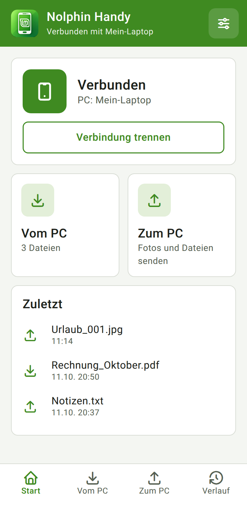 | 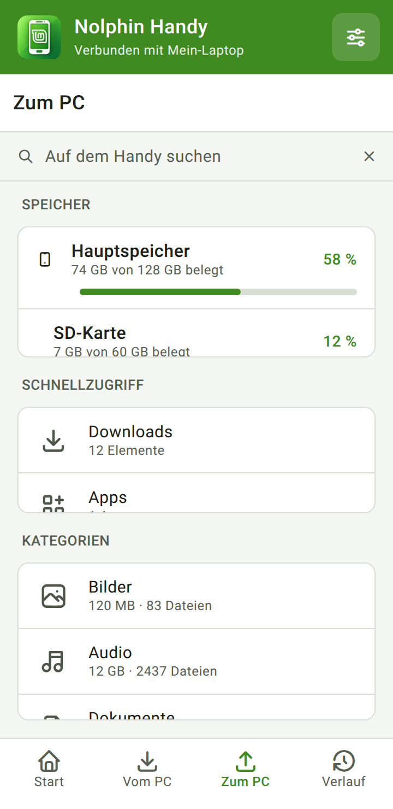 | 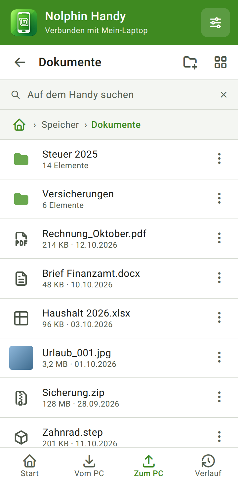 |

| Auswahl | Dokumente mit Reitern und Speicher-Schalter | Kopieren und Verschieben |
|:--:|:--:|:--:|
| 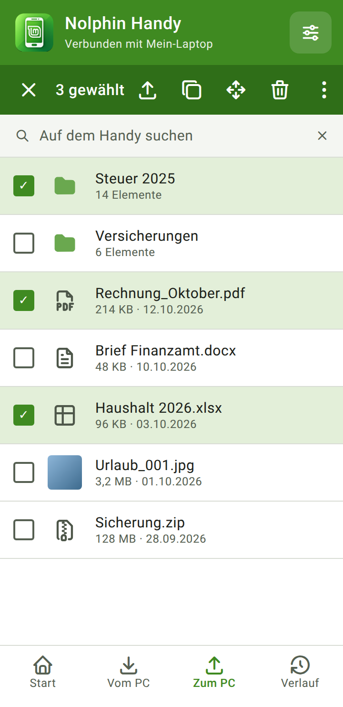 | 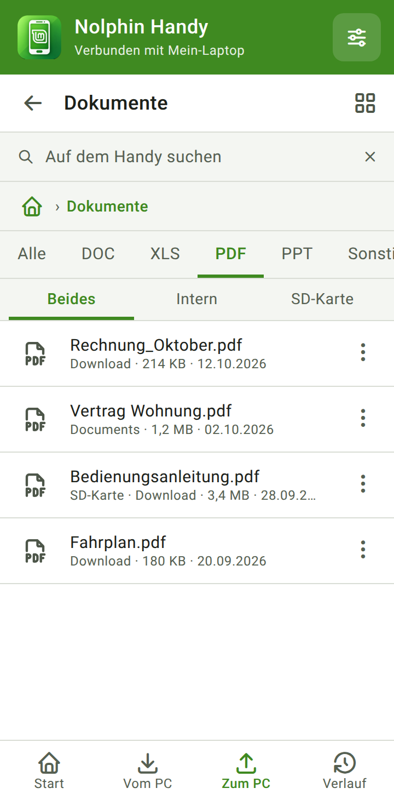 | 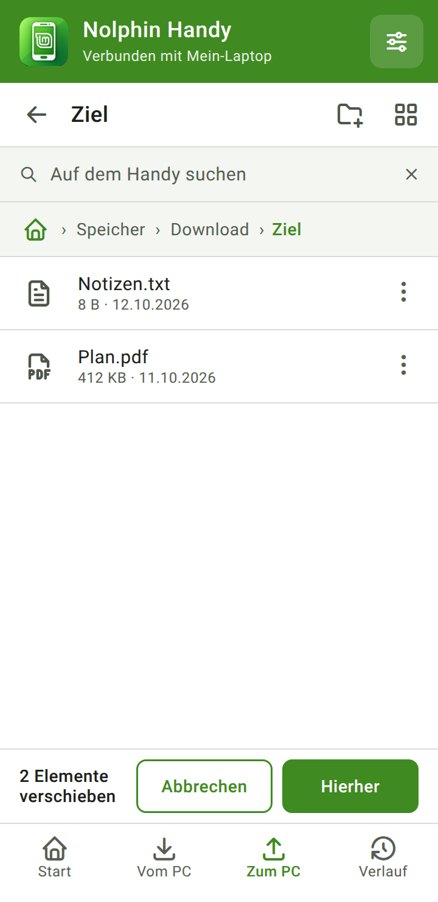 |

| Dunkel: Liste | Dunkel: Auswahl | Dunkel: Dokumente |
|:--:|:--:|:--:|
| 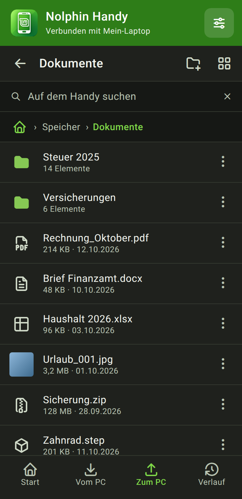 | 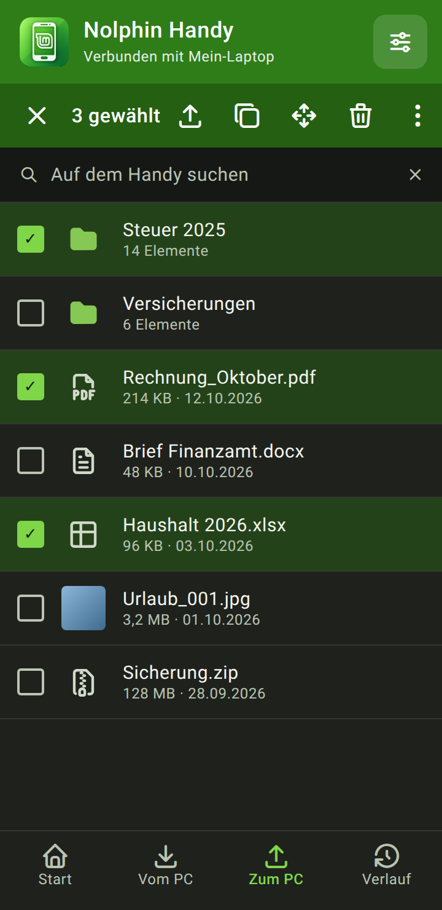 | 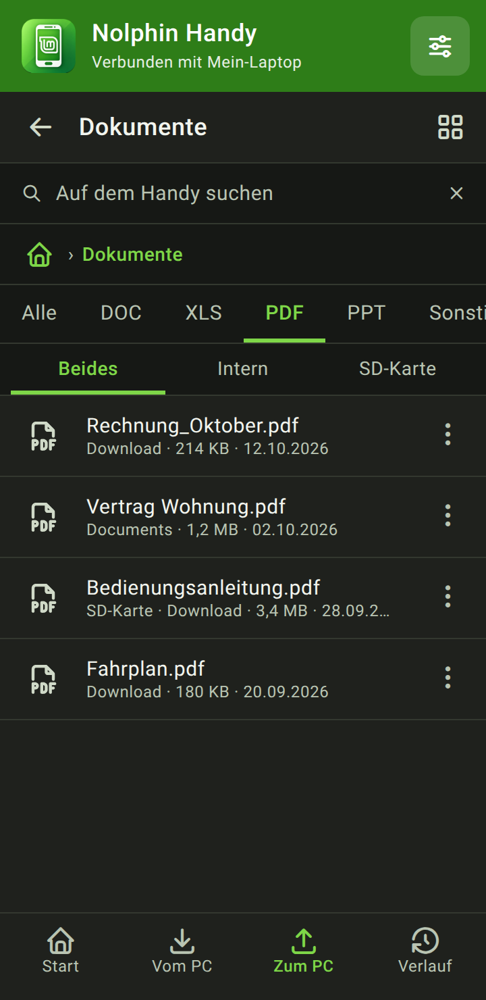 |

| Vom PC | Vom PC: Auswahl, dunkel | Start, dunkel |
|:--:|:--:|:--:|
| 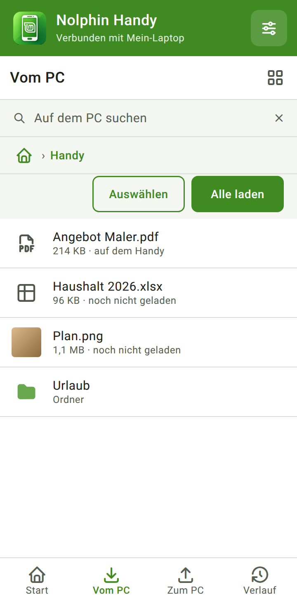 | 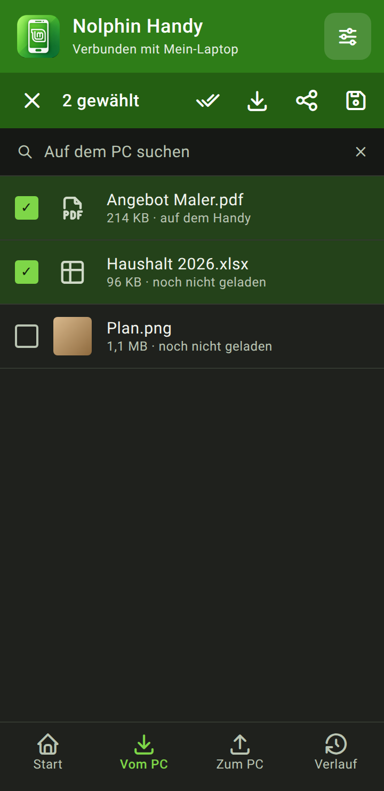 | 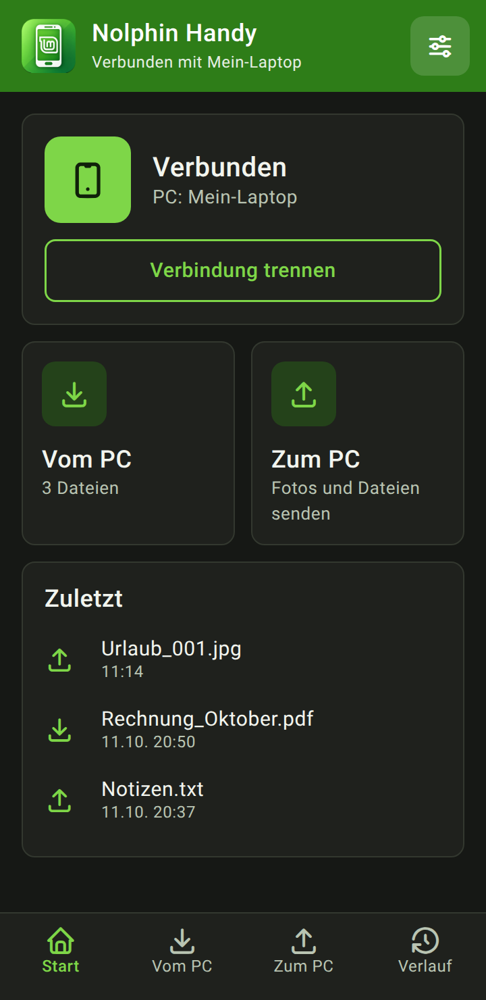 |

## Wo die Dateien am PC landen

Am PC gibt es **einen** Handy-Ordner: `~/Handy`. In Nolphin stehen links in der Seitenleiste zwei Einträge dafür:

| Seitenleiste in Nolphin | Ordner am PC | Wofür |
|---|---|---|
| **Handy** | `~/Handy` | Dateien, die das Handy laden soll. Sie erscheinen in der App unter **Vom PC**. |
| **Vom Handy** | `~/Handy/Vom Handy` | Alles, was Sie vom Handy senden: Dateien, Fotos aus Google Fotos, Dateien aus Google Drive und Ordner. |

* Einzelne Dateien liegen direkt in `Vom Handy`.
* Ordner liegen dort als Ordner mit allen Unterordnern.
* Gibt es einen Namen schon, wird nummeriert (`Name (1).ext`). Nichts wird überschrieben.

## Die vier Reiter

Unten stehen vier Reiter. Die Einstellungen öffnen Sie oben rechts.

| Reiter | Was er tut |
|---|---|
| **Start** | Zeigt „Verbunden“ oder „Nicht verbunden“, den Fortschritt einer Übertragung (mit Abbruch) und die letzten Übertragungen. |
| **Vom PC** | Dateien aus dem Ordner „Handy“ am PC, mit Vorschaubild. Antippen lädt eine Datei. Geladene Dateien lassen sich öffnen, teilen oder speichern. |
| **Zum PC** | Der Dateimanager des Handys. Hier senden Sie Dateien und Ordner an den PC. |
| **Verlauf** | Alle Übertragungen (bis 200) mit Ergebnis. |

Die **Einstellungen** enthalten: Verbindung trennen, neue Dateien automatisch laden (aus: erst nach Antippen), Zielordner für Dateien vom PC, Verlauf löschen.

## „Zum PC“ im Einzelnen

**Übersicht.** Hauptspeicher und SD-Karte mit Füllstand, Schnellzugriff (Downloads, Apps, Google Fotos, Cloud und andere Apps) und die Kategorien Bilder, Audio, Videos und Dokumente.

**Google und andere Apps.** Dateien, die nur in der Cloud oder im Speicher einer App liegen, sind keine Dateien auf dem Handy. Dafür gibt es zwei Einträge im Schnellzugriff. Beide öffnen die Auswahl des Systems. Was Sie dort wählen, geht an den PC.

* **Google Fotos:** die Fotoauswahl des Systems. Sie zeigt auch Bilder und Videos aus der Google-Cloud, die nicht auf dem Handy liegen (ab Android 13; früher die allgemeine Dateiauswahl).
* **Cloud und andere Apps:** die Dateiauswahl des Systems mit Google Drive und den Dateien anderer Apps, die einen Dokumentenanbieter haben. Mehrfachauswahl ist möglich.

Der Eintrag **Apps** zeigt dagegen nur Apps, die ihre Dateien in einem eigenen Medienordner ablegen (zum Beispiel WhatsApp). Die privaten Datenordner anderer Apps (`Android/data`) sind seit Android 11 für jede App gesperrt, auch mit „Zugriff auf alle Dateien“. Was andere Apps in Bilder, Dokumente, Audio oder Download speichern, finden Sie in den Kategorien.

**Ordner.** Oben stehen Pfeil zurück, Name des Ordners, „Neuer Ordner“ und der Wechsel zwischen Liste und Kacheln. Darunter folgen Suche und Pfadleiste. Tippen Sie auf das Haus, um zur Übersicht zu gelangen.

**Dokumente.** Reiter: **Alle, DOC, XLS, PDF, PPT, Sonstige.** „Sonstige“ enthält zum Beispiel ZIP, EPUB und Konstruktionsdateien (STEP, STL, DXF …). Die Liste zeigt Dokumente aus dem internen Speicher **und** von der SD-Karte zusammen (einstellbar mit dem Schalter unten). Dateien auf der SD-Karte tragen in der Zeile den Zusatz „SD-Karte“. Programm- und Systemdateien anderer Apps erscheinen nicht.

**Vorschau.** Fotos und Videos zeigen ein Vorschaubild, Audio das Albumbild (wenn die Datei eines hat), PDF die erste Seite. Alle anderen Dateien zeigen ein einfarbiges Symbol nach Dateiart.

**Suche.** Das Suchfeld sucht im aktuellen Ordner mit allen Unterordnern, in der Übersicht auf allen Speichern. In einer Kategorie filtert es die Liste.

**Speicher wählen.** Steckt eine SD-Karte, erscheint in den Kategorien und bei der Suche in der Übersicht ein Schalter **Beides / Intern / SD-Karte**. Standard ist „Beides“, es muss also nichts gewählt werden. In einem Ordner gibt es den Schalter nicht, weil der Ordner den Ort schon festlegt.

### Funktionen für Dateien und Ordner

Es gibt zwei Wege. Beide bieten dasselbe.

1. **Ein Element:** Tippen Sie rechts in der Zeile auf **⋮**. Es erscheint ein Menü: An den PC senden, Kopieren, Verschieben, Umbenennen, Eigenschaften, Löschen.
2. **Mehrere Elemente:** Drücken Sie lange auf ein Element. Es erscheinen Kästchen, und die Leiste oben wird grün. Dort stehen die Funktionen **An PC, Kopieren, Verschieben, Löschen** und **⋮** (Alle auswählen, Umbenennen, Eigenschaften). Tippen Sie weitere Elemente an, um sie zu wählen.

**Kopieren und Verschieben:** Wählen Sie die Elemente, tippen Sie auf Kopieren oder Verschieben, öffnen Sie den Zielordner und tippen Sie unten auf **Hierher**. Gibt es den Namen schon, hängt die App „(2)“ an. Einen Ordner in sich selbst zu kopieren oder zu verschieben lehnt sie ab.

**Löschen:** Die App fragt vorher nach. Gelöscht wird **endgültig**. Es gibt keinen Papierkorb.

**Sicherheit beim Kopieren, Verschieben und Löschen:**

* **Keine halben Dateien:** Kopiert wird erst in eine Temporärdatei im Zielordner und erst danach unter dem richtigen Namen abgelegt. Nach einem Fehler oder Abbruch bleibt nichts Halbes zurück.
* **Verschieben ohne Risiko:** Auf demselben Speicher wird nur umbenannt. Zwischen Speichern (zum Beispiel SD-Karte) wird kopiert, die Kopie per Prüfsumme geprüft, und erst dann verschwindet das Original, Datei für Datei. Ein Fehler lässt das Original stehen.
* **Verknüpfungen (Symlinks) werden nie verfolgt:** Beim Löschen verschwindet nur die Verknüpfung, nie ihr Ziel. Beim Kopieren gibt es dadurch keine Endlosschleifen.
* **Ein Fehler stoppt nicht alles:** Nicht lesbare Dateien oder Ordner werden ausgelassen. Danach zeigt die App, was geklappt hat und was nicht, mit dem Grund. Ein Ordner mit Fehlern gilt nicht als erledigt.
* Die Funktionen können Namenskonflikte nach den Regeln überspringen, umbenennen oder ersetzen und Vorgänge abbrechen. In der Oberfläche ist bisher nur „umbenennen“ (`Name (2)`) gewählt. Abbruch, Fortschrittsanzeige und die Auswahl der Regel folgen in einer späteren Stufe.

**Ordner an den PC:** Die App schickt einen Ordner **Datei für Datei mit allen Unterordnern**. Am PC entsteht derselbe Ordner im Eingangsordner „Vom Handy“. Gibt es den Ordner dort schon, kommen die Dateien hinein, und gleiche Namen werden nummeriert (`Name (1).ext`), nichts wird überschrieben. Für den ganzen Ordner gibt es **eine** Meldung und **einen** Eintrag im Verlauf. **Leere Unterordner** werden auch angelegt. Das braucht ein aktuelles Nolphin am PC (Feld `folders` in `/info`). Bei einem älteren Nolphin schickt die App den Ordner als **ZIP-Datei**.

**Zugriff:** Für den Dateimanager braucht die App „Zugriff auf alle Dateien“ (`MANAGE_EXTERNAL_STORAGE`). Das erlauben Sie einmal in den Systemeinstellungen. Ohne ihn bleibt nur die Systemauswahl.

## Einrichten

1. Klicken Sie in Nolphin am PC in der Seitenleiste auf **Handy**. Es erscheint ein QR-Code.
2. **Erster Scan:** Scannen Sie den Code mit der Kamera des Handys. Die Seite im Browser bietet die App zum Installieren an. Laden Sie sie und erlauben Sie die Installation. Warnungen von Chrome, Play Protect oder Mi Protect sind bei Apps außerhalb des Play Store normal.
3. **Verbinden:** Öffnen Sie die App, tippen Sie auf **QR-Code scannen und verbinden** und richten Sie die Kamera auf den Code am PC. Zum Scharfstellen tippen Sie aufs Bild. Die App liest den Code mit einem **eigenen QR-Leser** ([`QrDecoder.java`](src/org/nolphin/handy/QrDecoder.java)), ohne Bibliothek und ohne Google-Dienste. Statt zu scannen können Sie am PC den Link kopieren und in der App **Link aus der Zwischenablage einfügen** wählen.
4. **Wichtig:** Handy und PC müssen im **selben WLAN** sein. In einem anderen Netz, zum Beispiel einem Hotspot, erreicht die App den PC nicht.

Der Schlüssel im Link gilt, solange der Austausch am PC läuft, höchstens eine begrenzte Zeit. Nach einem Neustart von Nolphin oder bei einem neuen Code scannen Sie einfach erneut. Beim ersten Verbinden lädt die App vorhandene Dateien nicht. Neue Dateien landen in `Download/Nolphin`.

## Aktualisieren

Hat Nolphin am PC eine neuere App (höhere `versionCode`), zeigt die Startseite **Neue Version**. Ein Tipp auf **Aktualisieren** installiert sie über die alte, ohne Deinstallieren. Die Verbindung bleibt. Beim ersten Mal erlauben Sie der App einmal „Apps installieren“.

Eine neue Version bereitstellen:

1. `versionCode` in [`AndroidManifest.xml`](AndroidManifest.xml) erhöhen.
2. `./build.sh` ausführen.
3. Die APK nach `~/.local/share/nolphin/phone/nolphin-handy.apk` kopieren, oder Nolphin installieren (`sudo ninja -C build install` im Nolphin-Ordner).

## Bauen (Entwickler)

Voraussetzungen: JDK (`javac`, `keytool`) und das Android-SDK mit `android.jar`, `aapt2`, `d8`, `zipalign`, `apksigner`. Das SDK wird standardmäßig in `~/Android/Sdk` gesucht, sonst über `ANDROID_HOME`.

```bash
./build.sh
```

Ergebnis: `build/nolphin-handy.apk`.

Beim ersten Lauf entsteht ein Signaturschlüssel in `~/.config/nolphin/`. Er liegt **nicht** im Repository. Sein Passwort liegt im Systemschlüsselbund (`secret-tool`, Paket `libsecret-tools`), nie in einer Datei. Eine neue APK lässt sich nur über die alte installieren, wenn sie mit demselben Schlüssel signiert ist.

### Tests

```bash
./test.sh
```

Der Test läuft ohne Handy und prüft:

* den **QR-Leser**: 163 Prüfungen (Codes des C-Encoders von Nolphin, gedreht, verzerrt, unscharf, verrauscht, ein Bildschirmfoto und ein echtes dunkles, unscharfes Handyfoto),
* die **Link-Prüfung**: 34 Prüfungen,
* die **Dateioperationen** (`FileOps`): 50 Prüfungen für Kopieren, Verschieben (auch über Kopieren und Prüfen), Umbenennen, neuer Ordner, ZIP und Löschen. Dazu die Schutzfälle: Ordner nicht in sich selbst, Namenskonflikte (überspringen, umbenennen, ersetzen, Ordner zusammenführen), Verknüpfungen (nie verfolgt, keine Endlosschleife), nicht lesbare Dateien und Ordner (Rest wird erledigt, Fehler genannt), keine halben Dateien nach Fehler oder Abbruch, Original bleibt bei Fehler oder Abbruch, Fortschritt.

Der Test braucht den Nolphin-Quelltext im Nachbarordner `../nolphin-file-manager-master` (oder `NOLPHIN_ROOT`), außerdem `gcc` und GLib.

**Von Hand auf einem echten Handy geprüft** (mit Testdateien in einem eigenen Testordner, danach gelöscht): Neuer Ordner, Kopieren (auch mit Namenskonflikt, es entsteht `a (2).txt`), Verschieben, Umbenennen, Löschen mit Abbrechen und Bestätigen, Löschen eines ganzen Ordners, Mehrfachauswahl mit der Leiste oben, Eigenschaften, Ordner als ZIP an den PC (kam mit Unterordnern an, so läuft es noch bei älterem Nolphin) und der Schutz „Ordner nicht in sich selbst kopieren“. Der Ordner-Versand Datei für Datei ist am PC-Server automatisch getestet (Unterordner, Schutz vor `..`, Nummerierung) und auf dem Handy von Hand geprüft: Ein Testordner mit zwei Ebenen, einer Datei mit Umlauten und einem leeren Unterordner kam mit allen Dateien und Unterordnern an. Beim zweiten Senden entstanden `Name (1).txt`, nichts wurde überschrieben. Die Oberfläche selbst ist nicht automatisch getestet.

### Bilder der README neu erzeugen

```bash
google-chrome --headless=new --hide-scrollbars --virtual-time-budget=6000 \
  --force-device-scale-factor=2 --window-size=360,740 \
  --screenshot=docs/bilder/liste-hell.png "file://$PWD/docs/bilder/quelle.html#liste-hell"
```

Seiten: `start`, `uebersicht`, `liste`, `auswahl`, `dokumente`, `einfuegen`, `vompc`, `vompcauswahl`, jeweils mit `-hell` oder `-dunkel`. Die Seite `uebersicht` ist höher: `--window-size=360,900`. Die Quelle braucht beim Rendern Internet für die Symbolschrift.

## Aufbau des Quelltexts

| Datei (`src/org/nolphin/handy/`) | Aufgabe |
|---|---|
| `MainActivity` | Kopfleiste, Reiter, Verbindung, Versand |
| `HomeScreen`, `FromPcScreen`, `ToPcScreen`, `HistoryScreen`, `SettingsScreen` | Die Bildschirme |
| `FileOps` | Kopieren, Verschieben, Löschen, Umbenennen, ZIP (sicher, mit Ergebnisliste, Abbruch und Konfliktregeln) |
| `Ui` | Farben (hell und dunkel), Symbole, Listenzeilen |
| `Thumbs` | Vorschaubilder (Foto, Video, Albumbild, PDF, App-Symbol) |
| `SyncService` | Laden und Senden im Hintergrund |
| `Link`, `Connector`, `PcCheck`, `Conn` | Verbindung und gespeicherter Schlüssel |
| `QrDecoder`, `ScanActivity` | Eigener QR-Leser und Scanner |
| `Updater`, `Store`, `ShareActivity` | Aktualisieren, Verlauf, Teilen-Menü |

Der PC-Teil (der kleine Server in Nolphin) liegt im Projekt [nolphin-file-manager](https://github.com/kaysiebke-cell/nolphin-file-manager) (`src/nolphin-phone-server.c`, `src/nolphin-phone.c`).

## Sicherheit und Grenzen

* Die Verbindung läuft **unverschlüsselt im eigenen WLAN**. Der Schlüssel steckt im Link. Verwenden Sie das nur in einem Netz, dem Sie vertrauen.
* Löschen ist endgültig (kein Papierkorb).
* Bei einem älteren Nolphin am PC geht ein Ordner nur als ZIP.
* Der Zugriff auf alle Dateien ist mächtig. Die App nutzt ihn nur für den Dateimanager, und nur nach Ihrer Aktion.
* Die privaten Ordner anderer Apps (`Android/data`, `Android/obb`) kann Android keiner App zeigen. Cloud-Dateien und Dateien anderer Apps holen Sie über die Systemauswahl (siehe oben).
