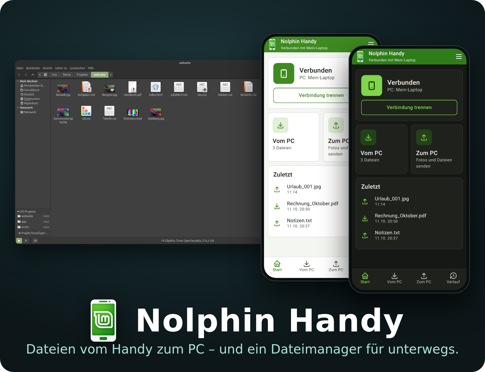
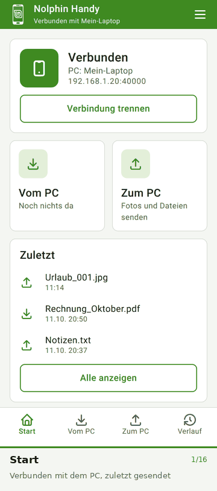
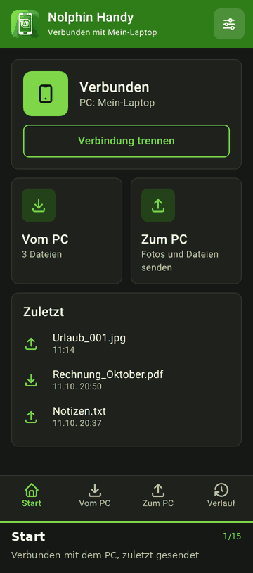

# Nolphin Handy

**Eine Android-App für den Dateiaustausch mit Nolphin am PC, in beide Richtungen, verschlüsselt – und zugleich ein Dateimanager für das Handy.**

Nolphin Handy ist die optionale Erweiterung zum Linux-Dateimanager [Nolphin](https://github.com/kaysiebke-cell/nolphin-file-manager). Der PC zeigt einen QR-Code, die App scannt ihn und verbindet sich verschlüsselt nur mit diesem PC. Danach laufen Dateien vom PC aufs Handy und vom Handy an den PC. Die App ist nur das Android-Framework: **keine Bibliotheken, kein Gradle.** Mindestens Android 10.

> **Hinweis:** Die Bilder in dieser README sind **nachgezeichnet mit Beispieldaten** (Quelle: [`docs/bilder/quelle.html`](docs/bilder/quelle.html)). Sie zeigen das Aussehen der App, aber keine echten Dateien oder Netzwerkdaten.

Der ganze Funktionsumfang in einem Durchlauf (16 Bilder, jeweils mit Beschriftung):

| Hell | Dunkel |
|:--:|:--:|
|  |  |

---

## Projektphilosophie

**Der PC bestimmt, das Handy folgt – und nichts geschieht im Verborgenen.**

* **Ehrlich statt vorgetäuscht:** Die App zeigt „Verbunden“ nur, wenn eine Verbindung wirklich besteht. Ein Widget behauptet nach einem Neustart nichts Altes.
* **Nur das, was Sie auslösen:** Gesendet oder geladen wird nur nach Ihrer Aktion. Gelöscht wird zuerst in den Papierkorb.
* **Nur Belegtes ist fertig:** Diese README beschreibt den Stand des Codes. Als „getestet“ gilt, was die Tests unter [Bauen und Testen](docs/bauen-und-testen.md) abdecken oder was am Handy angesehen wurde; offene Punkte stehen im [Umbaubericht](docs/umbau-4.28.md).

---

## Schnellstart

1. **Am PC:** In Nolphin links auf **Handy** klicken. Rechts erscheint ein QR-Code.
2. **Am Handy:** Die App öffnen, **QR-Code scannen und verbinden** tippen und die Kamera auf den Code halten.
3. **Fertig.** „Vom PC“ zeigt Dateien aus dem Ordner `~/Handy`, „Zum PC“ sendet Dateien, Fotos und Ordner an den PC.

Die Erstinstallation der App erfolgt von Hand (APK aus dem Nolphin-Ordner `/usr/local/share/nolphin/phone` oder selbst gebaut); Aktualisierungen kommen danach über die verschlüsselte Verbindung. Einzelheiten: [Einrichten und Aktualisieren](docs/einrichten-und-aktualisieren.md).

---

## Highlights

* **Verschlüsselt:** TLS mit einem Zertifikat, dessen Fingerabdruck im QR-Code steht. Die App spricht nur `https` und nur mit genau diesem PC. Siehe [Sicherheit und Grenzen](docs/sicherheit-und-grenzen.md).
* **Vier Reiter:** Start, Vom PC, Zum PC, Verlauf – mit Fortschritt, Abbrechen und allen Übertragungen (bis 200).
* **Dateimanager für das Handy:** interner Speicher und SD-Karte, Kopieren, Verschieben, Löschen, Umbenennen, neuer Ordner, Eigenschaften, Favoriten und zuletzt geöffnete Orte.
* **Ansicht nach Wunsch:** Liste, Raster oder Kompakt, Standard- oder große Vorschau, Namen ausblenden, versteckte Dateien, Sortierung (Name, Größe, Datum, Typ). Alles bleibt gespeichert, jedes Fenster hat seine eigene Wahl.
* **Auswahl mit einer Hand:** schmale Leiste oben, die Funktionen (Senden, Kopieren, Verschieben, Löschen, Mehr) unten in Daumenreichweite.
* **Zwei Fenster:** Quelle und Ziel nebeneinander oder untereinander, Kopieren und Verschieben mit Bestätigung.
* **Mit anderen Apps öffnen und bearbeiten:** über einen eigenen Datei-Anbieter, nur für die gewählte Datei.
* **ZIP und Stapelumbenennen:** entpacken mit Vorschau und Schutz vor unsicheren Pfaden, packen, mehrere Dateien mit Vorschau umbenennen.
* **Papierkorb (30 Tage)** und **Speicheranalyse** nur auf Wunsch, für den Bereich, in dem Sie gerade sind.
* **Fotos, Videos und Musik:** Vorschaubilder, Albumbilder, Titel, Interpret und Album.
* **Startbildschirm-Widget** in drei Größen (klein, kompakt, erweitert): Verbindung, Übertragung mit Fortschritt und Abbrechen, Dateien vom PC mit „Laden“, Senden. Siehe [Widget](docs/widget.md).
* **Eigener QR-Scanner** ohne Fremd-App, der auch schräg gehaltene Codes liest.
* **Hell und dunkel** in Mint-Grün, sachlich und ruhig.

---

## Dokumentation

| Nr. | Seite | Inhalt |
| --- | ----- | ------ |
| 1 | [Einrichten und Aktualisieren](docs/einrichten-und-aktualisieren.md) | Verbinden, Fingerabdruck, App aktualisieren |
| 2 | [Bedienung der App](docs/bedienung.md) | Reiter, Dateimanager, Ansicht, Auswahl, Papierkorb, ZIP, zwei Fenster, wo die Dateien am PC landen |
| 3 | [Startbildschirm-Widget](docs/widget.md) | Die drei Widgets, Zustände, Aktualisierung, Sicherheit, was geprüft ist |
| 4 | [Sicherheit und Grenzen](docs/sicherheit-und-grenzen.md) | Verschlüsselung, QR-Code, Berechtigungen, Grenzen |
| 5 | [Bauen und Testen](docs/bauen-und-testen.md) | Bauen, Tests, Bilder neu erzeugen |
| 6 | [Aufbau des Quelltexts](docs/quelltext.md) | Welche Datei was tut |
| 7 | [Umbaubericht 4.28](docs/umbau-4.28.md) | Was sich in der Oberfläche geändert hat und was geprüft ist |

Der PC-Teil (der kleine Server in Nolphin) liegt im Projekt [nolphin-file-manager](https://github.com/kaysiebke-cell/nolphin-file-manager) (`src/nolphin-phone-server.c`, `src/nolphin-phone.c`); seine Schnittstelle ist dort unter `docs/handy-austausch-api.md` beschrieben.

---

## Herkunft

Nolphin Handy entstand als optionale Erweiterung zu Nolphin, einem Dateimanager auf Basis von Nemo. Der Verlauf steht in der Git-Historie.

## Lizenz

**GPL-2.0-or-later**, wie Nolphin, der PC-Teil. Der Lizenztext steht in der Datei [LICENSE](LICENSE). Sie dürfen die App benutzen, ändern und weitergeben; Änderungen, die Sie weitergeben, müssen unter derselben Lizenz offen liegen.

---

**Nolphin Handy – Dateien austauschen. Verschlüsselt. Mit einer Hand.**
